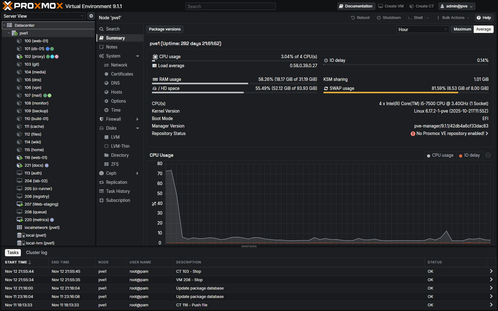
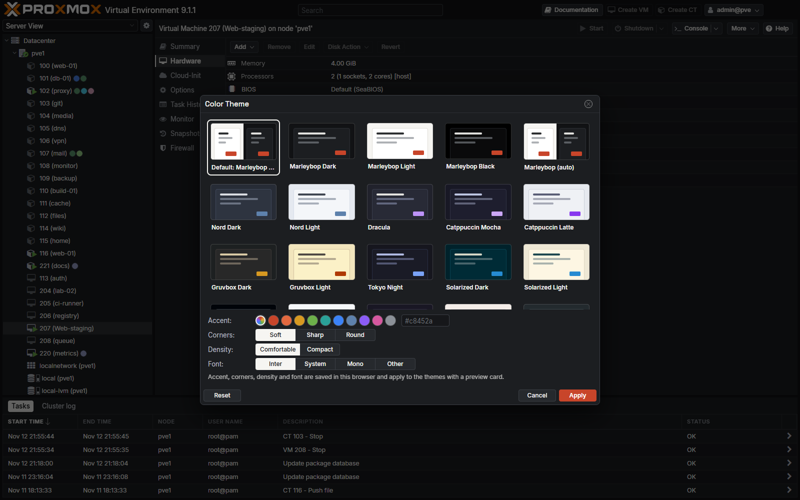
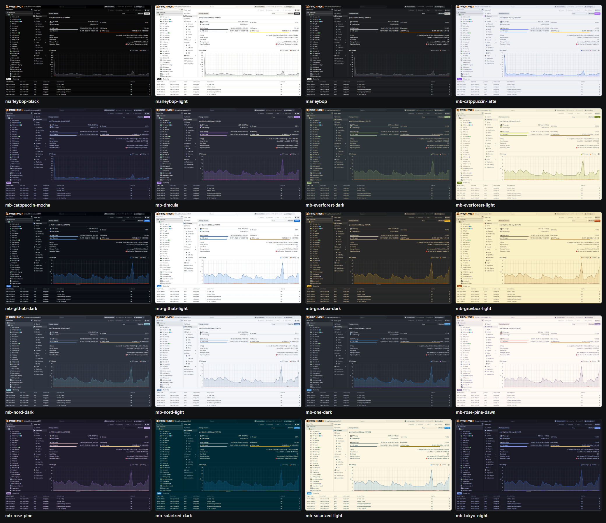
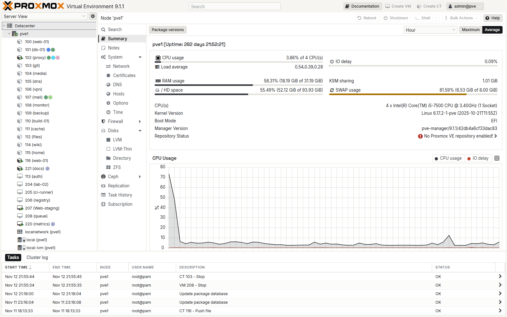
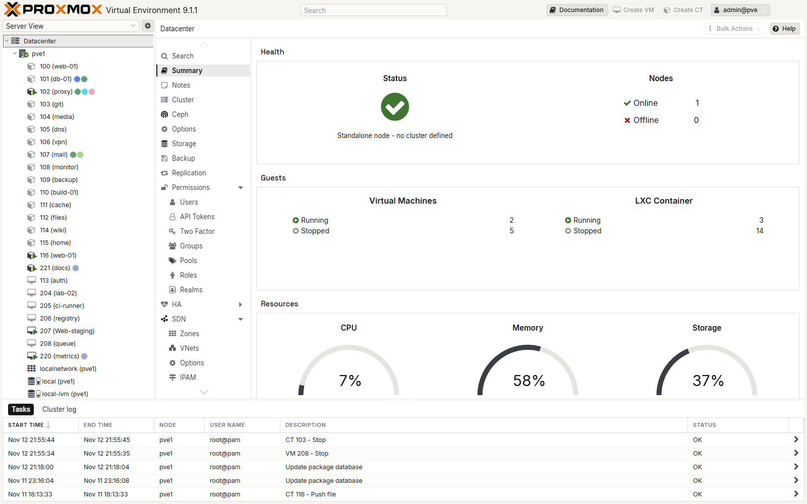
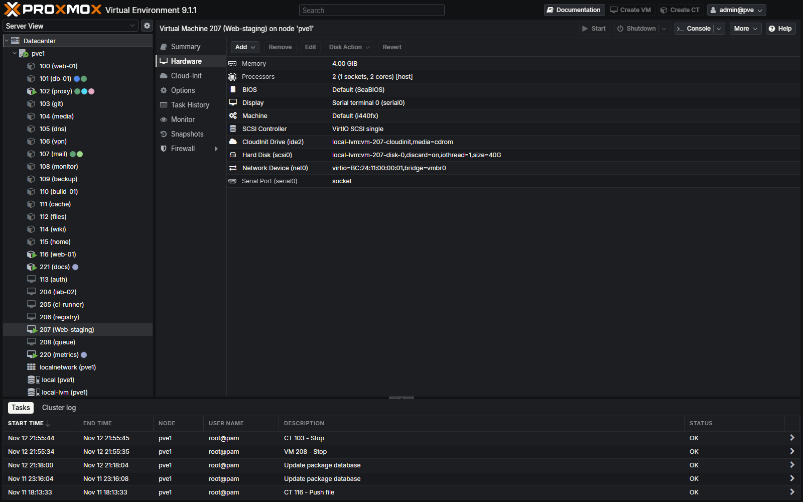
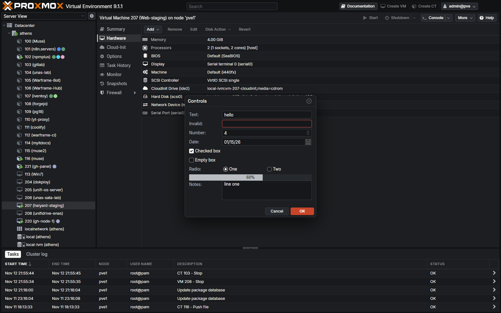

<picture>
  <source media="(prefers-color-scheme: dark)" srcset="docs/marleybop-lockup-on-dark-560.png">
  
</picture>

# Marleybop themes for Proxmox VE

**Marleybop · Tools**

Twenty themes for the Proxmox VE web interface, light and dark, with a theme picker built into the
web UI, per-browser options, and a way to make your own theme in a 26-line file. One command to
install, one to remove, and it comes back by itself after Proxmox updates.



Works on Proxmox VE 8 and 9 (built and tested on 9.1.1, widget-toolkit 5.1.2).

## Install

Run on the Proxmox node as root. The installer is one file with everything inside it; it downloads nothing else.

```bash
curl -fsSL https://raw.githubusercontent.com/Marleybop/marleybop-pve-theme/main/dist/install.sh | bash
```

Then open the web UI and hard-refresh once (Ctrl+Shift+R). Browsers that have not picked a theme get
**Marleybop**, light or dark to match the system. Everyone picks their own under
user menu > **Color Theme**.

In a cluster, run it on each node: the web UI files are per node.

## The picker

**Color Theme** in the user menu opens this instead of Proxmox's one-line dropdown. Clicking a card
previews the theme on the page behind; nothing is saved until **Apply**.



| Option | What it does |
|---|---|
| Accent | The colour of the main button in dialogs (and of selected tabs and checkboxes in themes that use their accent for those). Ten presets or any hex colour |
| Corners | Soft (4 px), Sharp (square) or Round (8 px) |
| Density | Comfortable, or Compact for more rows on screen |
| Font | Inter (bundled), your system font, monospace, or any font installed on your computer |

The options are saved in the browser, so each person and each computer can differ. If the picker
ever fails to open, Proxmox's own dialog opens instead.

## Themes



| Family | Themes |
|---|---|
| Marleybop | Dark, Light, Black (OLED), and auto |
| Nord | Dark, Light, auto |
| Catppuccin | Mocha, Latte, auto |
| Gruvbox | Dark, Light, auto |
| Solarized | Dark, Light, auto |
| GitHub | Dark, Light, auto |
| Rosé Pine | Main, Dawn, auto |
| Everforest | Dark, Light, auto |
| Dracula, Tokyo Night, One Dark | one each |

The "auto" entries follow the system light/dark setting live, without a reload.

| | |
|---|---|
|  |  |
|  |  |

What is restyled: fonts (Inter, Space Grotesk for titles, JetBrains Mono for code, all served from
the node), thin scrollbars, tables and column headers, the resource tree with drawn expander arrows,
buttons, tabs, side navigation, form fields, drawn checkboxes and radios, menus, dropdowns, tooltips,
dialogs, progress bars, gauges, the RRD charts, notes, the date picker, and the login screen.

## Your own theme

```bash
marleybop-pve-theme new my-theme mb-nord-dark    # start from any existing theme
nano /etc/marleybop-pve-theme/themes/my-theme.theme
marleybop-pve-theme reapply
```

A theme is a name, `mode=dark` or `light`, and 24 colours:

```ini
name=My Theme
mode=dark
bg=#111214              # the page behind the panels
surface=#1c1e21         # panels
raised=#26292d          # buttons, chips, progress track
border=#2b2e33
border_strong=#3a3e44   # inputs and button edges
text=#f6f5f2
text2=#b9bdc2           # secondary text and icons
muted=#8c9198           # column headers, hints
accent=#c8452a          # the main button in a dialog
on_accent=#ffffff
link=#e2683f
sel=#f6f5f2             # selected tab, checked box, pressed toggle
on_sel=#16181b
bar=#b9bdc2             # usage bars and gauges
good=#6db04a
warn=#e0a93b
bad=#ff8a80             # error text
bad_fill=#e5534b        # error borders and critical bars
chart1=#b9bdc2          # chart series, in order
...
chart6=#8c9198
```

Names must be lowercase words of up to 10 letters joined by `-` (a rule of the Proxmox server, which
is also why the bundled ones are called `mb-nord-dark` and so on). Everything else (hover, selection,
zebra rows, focus, hints) is worked out from those colours. Your themes survive updates and uninstall.

## Commands

| | |
|---|---|
| `marleybop-pve-theme list` | The themes, and which one is the default |
| `marleybop-pve-theme default <name>` | The theme for browsers that have not picked one. `none` gives Proxmox's own back |
| `marleybop-pve-theme new <name> [copy-from]` | Start your own theme |
| `marleybop-pve-theme reapply` | Rebuild everything, after editing a theme (the apt hook runs this after Proxmox updates) |
| `marleybop-pve-theme status` | What is installed |
| `marleybop-pve-theme uninstall` | Remove every change |

Install without touching the default: `curl -fsSL <url> | bash -s -- install --no-default`.

## What it changes on the node

Everything is undone by `marleybop-pve-theme uninstall`, which leaves the two edited Proxmox files
byte-for-byte as they were (the self-test checks this).

| Where | What |
|---|---|
| `/usr/local/share/marleybop-pve-theme/` | The engine: `apply.sh`, the style layer, the palettes (`/usr/local/sbin/marleybop-pve-theme` links to it) |
| `/usr/share/javascript/proxmox-widget-toolkit/themes/` | One `theme-*.css` per theme, five `marleybop-*.woff2` fonts, `marleybop-theme.js` |
| `.../proxmox-widget-toolkit/proxmoxlib.js` | One line per theme in `theme_map`, so they are in the Color Theme list |
| `/usr/share/pve-manager/index.html.tpl` | One `<script>` line; `-mb<version>` added to the theme stylesheet's cache key; the automatic dark theme points at the default theme |
| `/etc/apt/apt.conf.d/99marleybop-pve-theme` | Re-applies the two edits after a Proxmox package update replaces those files |
| `/etc/marleybop-pve-theme/` | The default setting, your own themes, and an untouched copy of the two edited files |

`pveproxy` is reloaded (not restarted), so open consoles stay connected. Themes from other tools in
the same folder are left alone.

## How it works

Proxmox's dark theme is a small stylesheet: the list of everything in the UI that needs a colour.
At install time each theme is **built on the node** from three parts:

1. the node's own `theme-proxmox-dark.css`, with every colour swapped for a variable (`src/palette.sed`).
   Light themes drop its icon-inverting filters; the rest applies to both.
2. the style layer (`src/layer.css`): type, spacing, shapes, drawn controls. It names no colours.
3. the theme's palette, as a `:root` block.

Because the base comes from the node itself, widgets that a Proxmox update adds to its dark theme
are picked up by every theme on the next re-apply, and a theme stays a 26-line file.

The RRD charts take their colours from JavaScript, not CSS, so `src/marleybop-theme.js` recolours
them from the palette. It also applies the per-browser options and provides the picker.

## Working on it

| File | What |
|---|---|
| `src/layer.css` | The style layer |
| `src/palette.sed` | Stock dark colour to variable |
| `tools/gen-themes.sh` | The table the bundled palettes in `src/themes/` are written from |
| `src/marleybop-theme.js` | Options, chart colours, the picker |
| `src/apply.sh` | Build, install, re-apply, uninstall |
| `build.sh` | Packs everything into `dist/install.sh` |
| `test/run.sh` | Self-test of `apply.sh` against stand-in files; no node or root needed |

```bash
bash test/run.sh    # 28 checks
./build.sh          # dist/install.sh
./build.sh --dev    # also every theme into dist/dev/themes/, from dev/theme-proxmox-dark.css (copy it from a node)
```

`tools/shot.cjs` screenshots about 35 views and dialogs of a real node with the dev build swapped in
by the browser, so nothing has to be installed to see a change; `tools/sheet.cjs` makes a contact
sheet. They need `playwright-core` (uses the installed Edge) and a password-less read-only user:

```bash
# on the node, once
pveum user add marleybop-theme@pve && pveum acl modify / -user marleybop-theme@pve -role PVEAuditor
# on the PC
node tools/shot.cjs --host root@<node> --url https://<node>:8006 --node <name> --vm qemu/<id> --ct lxc/<id> \
    --serve dist/dev/themes --inject --theme mb-nord-dark --out shots
```

`--anonymize` swaps guest names, addresses and the user name for generic ones, as in the pictures here.
Bump `VERSION` for every release: it is part of the stylesheet's cache key.

## Not covered

- The noVNC and xterm.js consoles, the mobile UI and the API viewer are separate pages with their own styles.
- Proxmox Backup Server and Datacenter Manager.
- Hardware sensor readouts: that needs a change to the node's API code, which this project does not touch.

## Credits

The idea of putting themes in the native selector and re-applying them from an apt hook comes from
[ProxMorph](https://github.com/IT-BAER/proxmorph) by IT-BAER, found through
[Virtualization Howto](https://www.virtualizationhowto.com/2026/02/a-small-change-to-my-proxmox-web-ui-made-it-feel-more-modern/).
No ProxMorph code or CSS is included. The palettes of Nord, Dracula, Catppuccin, Gruvbox, Tokyo Night,
Solarized, GitHub, Rosé Pine, Everforest and One Dark belong to their authors.

Code: MIT. Fonts: Inter, JetBrains Mono and Space Grotesk under the SIL Open Font License (`src/fonts/`).
Proxmox is a trademark of Proxmox Server Solutions GmbH; this project is not affiliated with it.
